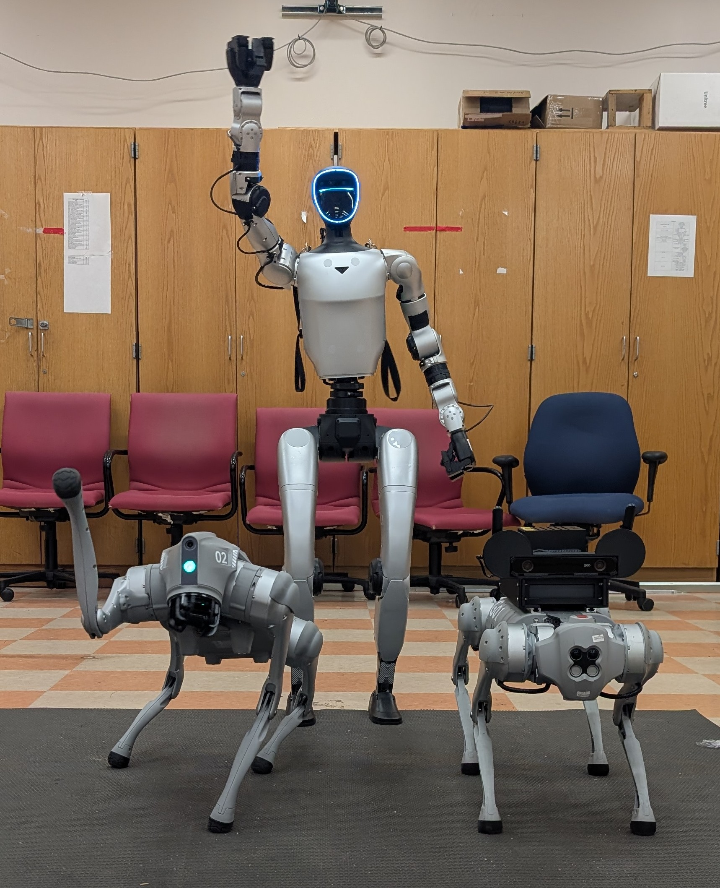

# ME 3050 · Modeling and Analysis of Dynamic Systems

**Clemson University · Department of Mechanical Engineering · 3 credits**

Model physical systems, predict their response, and test what your models can explain.

[Open the course website](https://sriram-2502.github.io/modeling_course/)

## Course description

This course presents techniques for developing and analyzing models of mechanical, electrical, electromechanical, fluid, and thermal systems. Students use analytical and numerical methods to determine transient, steady-state, and frequency responses. Topics include stability analysis, state-space representation, free and forced vibration in single- and multi-degree-of-freedom lumped-parameter systems, and methods of vibration absorption and isolation.

## Course learning objectives

Develop mathematical models for mechanical, electrical, electromechanical, and fluid systems.

## Skills and exam preparation

The web lectures include optional skill checks on physical modeling, first- and second-order systems, Laplace transforms and convolution, transfer functions, state space, stability, and feedback. Each check links an engineering prediction to an example or experiment.

| Assessment | Study focus |
| --- | --- |
| Exam 1 | Impulse response and convolution, equilibria, transfer functions, damping, and inverse Laplace transforms. |
| Exam 2 | Spring–damper assemblies, rotational and translational motion, state choices, block reduction, and stability. |
| Final Exam | Suggested preparation covers circuit, motor, fluid, thermal, and feedback models, with earlier methods revisited across domains. |

## Course schedule

Expand a topic to find its lecture PDFs. The web lectures pair the course material with worked examples and interactive simulations.

<strong>Dynamic response and modeling foundations</strong>

| Lecture | Topic | Materials |
| --- | --- | --- |
| 01 | Course Overview and Math Recap | [Lecture PDF](site/materials/lectures/lecture-01.pdf) |
| 02 | Math Review | [Lecture PDF](site/materials/lectures/lecture-02.pdf) |
| 03 | First-Order Systems | [Lecture PDF](site/materials/lectures/lecture-03.pdf) |
| 04 | Second-Order Systems | [Lecture PDF](site/materials/lectures/lecture-04.pdf) |
| 05 | Laplace Transforms | [Lecture PDF](site/materials/lectures/lecture-05.pdf) |
| 06 | Convolution and System Response | [Lecture PDF](site/materials/lectures/lecture-06.pdf) |
| 07 | Transfer Functions and Stability | [Lecture PDF](site/materials/lectures/lecture-07.pdf) |
| 08 | Exam 1 Review | [Lecture PDF](site/materials/lectures/lecture-08.pdf) |

<strong>Mechanical systems and stability</strong>

| Lecture | Topic | Materials |
| --- | --- | --- |
| 09 | Rigid-Body Dynamics | [Lecture PDF](site/materials/lectures/lecture-09.pdf) |
| 10 | Drive Kinematics | [Lecture PDF](site/materials/lectures/lecture-10.pdf) |
| 11 | Springs and State Space | [Lecture PDF](site/materials/lectures/lecture-11.pdf) |
| 12 | Dampers and State Space | [Lecture PDF](site/materials/lectures/lecture-12.pdf) |
| 13 | Transfer Functions and Block Diagrams | [Lecture PDF](site/materials/lectures/lecture-13.pdf) |
| 14 | Coupled Systems and the Quarter-Car Model | [Lecture PDF](site/materials/lectures/lecture-14.pdf) |
| 15 | Phase Portraits and Stability | [Lecture PDF](site/materials/lectures/lecture-15.pdf) |
| 16 | Exam 2 Review | [Lecture PDF](site/materials/lectures/lecture-16.pdf) |

<strong>Electrical, fluid, and thermal systems</strong>

| Lecture | Topic | Materials |
| --- | --- | --- |
| 17 | Electrical Circuits | [Lecture PDF](site/materials/lectures/lecture-17.pdf) |
| 18 | Electromechanical Coupling | [Lecture PDF](site/materials/lectures/lecture-18.pdf) |
| 19 | Galvanometers and DC Motors | [Lecture PDF](site/materials/lectures/lecture-19.pdf) |
| 20 | Fluid Systems and Mass Conservation | [Lecture PDF](site/materials/lectures/lecture-20.pdf) |
| 21 | Fluid Systems and Electrical Analogies | [Lecture PDF](site/materials/lectures/lecture-21.pdf) |
| 22 | Thermal Systems | [Lecture PDF](site/materials/lectures/lecture-22.pdf) |

<strong>System representations and feedback</strong>

| Lecture | Topic | Materials |
| --- | --- | --- |
| 23 | Connecting System Representations | [Lecture PDF](site/materials/lectures/lecture-23.pdf) |
| 24 | Introduction to Feedback Control | [Lecture PDF](site/materials/lectures/lecture-24.pdf) |

## About the instructor

**Sriram Krishnamoorthy, Ph.D.**

I’m a postdoctoral researcher in Clemson’s Department of Mechanical Engineering, where I earned my Ph.D. in 2026. My research uses data-driven models and control to help legged robots move and keep their balance on challenging terrain.

[Google Scholar](https://scholar.google.com/citations?hl=en&user=-kMTFjwAAAAJ) · [LinkedIn](https://www.linkedin.com/in/sriramsundarks/) · [GitHub](https://github.com/sriram-2502)

## Clemson Creative Inquiry · Mission Control

In my one-credit Creative Inquiry course, students build a hand-gesture interface and use it to guide a quadruped robot through a maze. They start in simulation and then test on hardware. [Explore Mission Control](https://dyco-ai.github.io/go1_gesture_tracking/)

I previously taught ME 3050 at Clemson University in Fall 2026.
